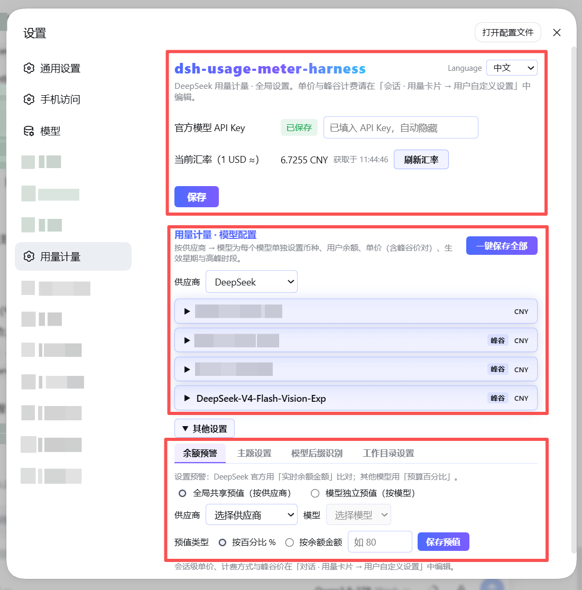
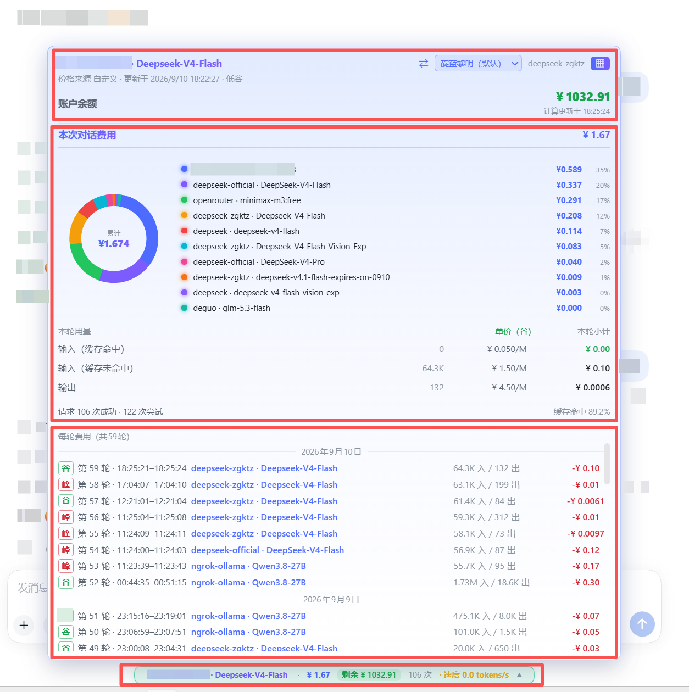

# dsh-usage-meter-desktop

[English](README.md) | [简体中文](README.zh-CN.md)

A real-time usage / cost / balance meter plugin for **DeepSeek Harness (DSH)**.
See tokens, spending and real wallet balance right next to the chat input — for
the official DeepSeek models **and** any custom model registered in DSH.



## 3.1.0 — one build, both DSH generations

In one line: **the same package installs and runs on DSH 0.1 (web profile) and DSH 0.2
(desktop) — nothing to choose, no per-host patch.**

Before 3.1.0 each build hard-required a service the other generation lacked:

| `inject` | 2.0.x | 3.0.0 | 3.1.0 |
| --- | --- | --- | --- |
| declared | `['settings','sessionProjections']` | `['sessionProjections','webServer']` | `['sessionProjections']` |
| DSH 0.1 (web) | ✅ | ⚠️ works, but only through a probe | ✅ |
| DSH 0.2 (desktop) | ❌ `ctx.settings.register` is gone | ✅ | ✅ |

How one build covers both:

- **`sessionProjections` is the only required service.** Both generations provide it;
  it carries the readout.
- **`webServer` is optional, resolved through a child fiber.** `ctx.inject(['webServer'], …)`
  activates when the service appears and stays pending when a composition never
  provides it. Routes registered before that point are queued and flushed in order, so
  the plugin mounts on a host that resolves un-injected services (0.1) *and* on one
  that does not (0.2). A composition with no `webServer` at all runs without HTTP
  routes and keeps the readout.
- **The host settings service is not used.** `src/settings-scope.ts` owns a JSON file
  in the plugin's data directory, so 0.1's `ctx.settings.register` and 0.2's
  `SettingsForms` are equally irrelevant. The settings UI rides the `settings.section`
  client slot, which both generations declare.
- **The client half is generation-agnostic.** `inject = ['slots']`, `dsh.client.inject`
  names `dsh-client-ui-conversation` + `dsh-client-locale` (identical in both hosts),
  and `useProjection` / `useChat` are probed with fallbacks.

Verified on this machine: on DSH 0.1.5-rc.1 the plugin mounts, every
`/api/usage-meter/*` route answers 200, and `__DSH_BOOT__` lists
`dsh-usage-meter-desktop/client.js` in the application batch (bundle served,
321 076 bytes). On DSH 0.2 the same package serves the desktop UI as before.
`scripts/test-host-matrix.mjs` reproduces the three host shapes against real cordis —
service already present, service arriving late, service never provided — and every
case must pass.

The 3.0.0 notes below still describe what changed against 2.0.39; they apply to this
build too.

| | 2.0.x (web build) | 3.x (this build) |
| --- | --- | --- |
| npm package | `@faith1688/dsh-usage-meter-harness` | `dsh-usage-meter-desktop` |
| Plugin id | `usage-meter` | `usage-meter-desktop` |
| Data directory | `$DSH_HOME/usage-meter/` | `$DSH_HOME/usage-meter-desktop/` |
| Config file | `usage-meter.json` | `usage-meter-desktop.json` |
| Host | DSH 0.1 / web profile | **DSH 0.1 web and DSH 0.2 desktop** |

Data directories and filenames are deliberately separate, so installing both never
clobbers the other's config or ledger.

### What changed in 3.0.0 vs 2.0.39

**1. DSH 0.2 support (without this it does not start)**

- DSH 0.2 removed `ctx.settings.register`, replacing it with presentation-only
  `SettingsForms`. The old call threw
  `TypeError: ctx.settings.register is not a function` and the whole plugin reported
  `1 entry did not activate`. 3.0.0 ships its own file-backed settings scope
  (`src/settings-scope.ts`) with 0.1 semantics: schema defaults ← composition base ←
  persisted user values.
- DSH 0.2 no longer resolves a service that was not injected. The old
  `ctx.get('webServer')` probe reads as absent on 0.2, so every
  `/api/usage-meter/*` route silently disappeared and the client had no data channel.
  3.0.0 makes `webServer` a required inject.

**2. New: import pricing from other billing plugins on this machine**

Next to "Export billing config / Import billing config" in a model editor there is now
a third button, **"Import pricing from other plugins"**:

- It scans installed billing plugins (currently `dsh-cost-meter`) for every model price
  they know about.
- Rows are ranked by model-name similarity (prefix 0.45 + bigram Dice 0.35 + token
  Jaccard 0.20), so the closest match is on top instead of you hunting for it.
- "Use this" writes into **the model this card owns** (not the provider from the
  source); the source currency is converted to the target model's currency at the
  current rate.

**3. Peak/off-peak windows travel with the price (correctness fix)**

Importing unit prices without the schedule is always wrong: if the source plugin puts
peak hours at different clock times and we keep our own windows, the same price gets
applied in the wrong hours. 3.0.0 carries `peakWindows` / `peakDays` across and converts
cost-meter's **UTC hours** into Beijing-time minutes (`+8`, cross-midnight clamped to
24:00).

**4. Fixed in 3.0.0: no more invented peak/off-peak**

Symptom: Kimi-K3's peak and off-peak numbers were identical (20/20, 2/2, 100/100), yet
it showed a "peak/off-peak" badge with the peak switch on.

Two root causes:

1. The source plugin's `config.peakWindows` is **config-wide**: as soon as any single
   model has peak pricing, the field exists. The old code applied it to every row, so
   models without peak pricing inherited the badge.
2. The old code only checked whether a `peak` field existed, never whether its numbers
   differed. Identical peak and off-peak values were still treated as peak pricing.

Fix: decide **per row** — three identical values mean `peak = null` and the window is
cleared too. The server applies the same test when writing, so it no longer emits
`peak/offPeak/peakWindows/peakDays` for a flat price. Loading an existing config also
normalises stale data, so previously imported fake peak pricing heals itself.

Measured on this machine (832 candidates): 832 rows had peak pricing before the fix;
after it, **only 9 do**, all DeepSeek official models (`deepseek-flash`,
`deepseek-v4-flash`, `deepseek-v4-pro`, `deepseek-v4.1-flash`, plus their opencode-go
channel). Kimi, Qwen, Gemini and the rest are now flat.

**5. Price edits take effect immediately**

Previously you had to collapse and reopen the capsule to see a new unit price. Two root
causes: the override kept its own stale row table (editing prices updated `prices` but
never the rows), and the host projection only recomputes on session events, which a
price edit does not produce. Fix: invalidate the row table when only prices change, plus
a new `GET /api/usage-meter/pricing` that reads the live effective price directly and is
layered over the projection on the client.

**6. Settings page rework + export in the capsule drawer**

- The settings page is now two cards, "Global" and "Model pricing"; API Key / exchange
  rate / official price sync moved into the first card, and the model card header shows
  supplier and model counts.
- The capsule's price drawer gained **"Export current pricing"**: it writes the current
  model's unit prices and peak windows as a billing config file under
  `$DSH_HOME/usage-meter-desktop/exports/`.

## Install

This package is the **desktop build (3.0.0)**. It is installed from a local tarball into
the `desktop` profile — it is not fetched from the npm registry, and it does not touch
the web build.

**1. Build the tarball (or use the one shipped in the release assets):**

```bash
cd desktop
npm install          # esbuild + typescript
npm run bundle       # tsc for the host half, then esbuild for lib/client.js
npm pack             # -> dsh-usage-meter-desktop-3.0.0.tgz
```

**2. Drop it into the desktop profile and point the profile at it:**

```
$DSH_HOME/profiles/desktop/dsh-usage-meter-desktop-3.0.0.tgz
```

```jsonc
// $DSH_HOME/profiles/desktop/package.json
{
  "dependencies": {
    "dsh-usage-meter-desktop": "file:./dsh-usage-meter-desktop-3.0.0.tgz"
  }
}
```

**3. Register the bundle, then restart DSH:**

```jsonc
// dsh.profile.bundles must contain the plugin id
"dsh-usage-meter-desktop"
```

```bash
# from the profile directory
pnpm install
# then restart the desktop app (or `dsh web`)
```

**Verifying it loaded:** the usage capsule appears next to the chat input after the
first message. If it does not, check the host log for `1 entry did not activate` — that
means a 2.0.x build was installed on DSH 0.2, or the bundle id was not registered.

**Upgrading:** replace the tgz and the version in `package.json`, run `pnpm install`
again, restart. The data directory `$DSH_HOME/usage-meter-desktop/` is preserved.

---

Looking for the **web build (2.0.x)** instead? It lives in the repo root — see
[`../README.md`](../README.md).

## Web build install (2.0.x, for reference)

> These three methods install the **web build**, not this package. They are kept here
> only because this file was branched from the web README.

> Prerequisite (methods 1 & 2): the DSH CLI itself runs on pnpm — install it once per machine:
> `npm install -g pnpm` (or `corepack enable`), then verify with `pnpm --version`.

Pick one of the three methods. **Methods 1 and 2 need pnpm** (a one-time machine
setup used by the DSH CLI itself): `npm install -g pnpm` or `corepack enable`.

### Method 1 — npm registry via DSH CLI (needs pnpm)

```bash
dsh plugin --profile web add --verbose @faith1688/dsh-usage-meter-harness@latest
```

(`--verbose` shows the install progress; drop it if you prefer a quiet install.
`@latest` explicitly requests the newest release — always install this way.)

### Method 2 — GitHub via DSH CLI (needs pnpm)

```bash
dsh plugin --profile web add --verbose github:faith1688/dsh-usage-meter-harness#main
```

(`--verbose` shows the install progress. `#main` always installs the latest
main branch — the newest release.)

### Method 3 — one-line installer, no pnpm (recommended)

```bash
npx -y @faith1688/dsh-usage-meter-harness@latest
```
One command: installs into the DSH web profile and registers the bundle (idempotent).
(`@latest` explicitly requests the newest release — always install this way.)

Prefer not to use npx? The same logic ships as scripts in the repo:

Windows (cmd):

```bat
curl -fsSL https://raw.githubusercontent.com/faith1688/dsh-usage-meter-harness/main/scripts/install.cmd -o "%TEMP%\um-install.cmd" && "%TEMP%\um-install.cmd"
```

Linux / macOS:

```bash
curl -fsSL https://raw.githubusercontent.com/faith1688/dsh-usage-meter-harness/main/scripts/install.sh | sh
```

The script does everything for you: `cd` into the DSH web profile, installs the
package with visible progress, and registers the bundle in `dsh.profile.bundles`
(idempotent — safe to re-run after upgrades).

> Note: Method 3 uses plain `npm` and does **not** do pnpm coordination. If your
> profile is managed with pnpm (the default for `dsh plugin`), prefer Method 1.

After any method: **restart `dsh web`**.

## Updating

The desktop build is installed from a local tarball, so upgrading is:

1. Replace `dsh-usage-meter-desktop-<old>.tgz` in the profile with the new one.
2. Update the version in `$DSH_HOME/profiles/desktop/package.json`.
3. `pnpm install` from the profile directory.
4. Restart DSH.

`$DSH_HOME/usage-meter-desktop/` (config, ledger, exports) is never touched by an
upgrade — only the code under `node_modules/` is replaced.

---

The rest of this section is the **web build (2.0.x)** upgrade path, kept for reference.
When upgrading the web build, always ask for the new version explicitly — a bare `add`
can be skipped by pnpm as "already satisfied":

```bash
dsh plugin --profile web add @faith1688/dsh-usage-meter-harness@latest
```

or, from inside the profile directory (`~/.dsh/profiles/web`):

```bash
pnpm update @faith1688/dsh-usage-meter-harness
```

(You may also pin an exact version, e.g. `...@1.0.28`.)

> **Marketplace update failed?** If it reports *"targeted vX but installed vY; the
> previous version was restored automatically"*, that is pnpm's **new-release
> cooldown** (`minimumReleaseAge` — a freshly published version is skipped for
> roughly 24h). Your install is not broken and nothing in your config or data was
> touched. **Wait 24 hours** and click update again, or upgrade right away with the
> `npx` command below (or add this package name, without a version, to
> `minimumReleaseAgeExclude` in your profile's `pnpm-workspace.yaml`).

**If your `package.json` binds the plugin via a `file:` path or a pin that `add`
won't override** (you see `Already up to date` / `downloaded 0`), use the
one-line installer instead — it always requests `@latest`, which rewrites the
binding to `^<latest>` and upgrades in a single command:

```bash
npx -y @faith1688/dsh-usage-meter-harness@latest
```

(Re-running this same command is the permanent update path: it is idempotent
and upgrades regardless of whether you currently bind via `file:`, a pin, or `^`.)

After updating: **restart `dsh web`** (or reload the browser page). Note that
restarting alone never fetches a new version — it only reloads what is already
in `node_modules`.

**Why this never duplicates the mount entry and never touches your config:**

- The mount entry lives **inside the package** (`cordis.patch.yml`, the
  `dsh.bundle` mechanism). Every release ships its own complete entry; DSH reads
  it from the installed package at startup — installing a newer package
  automatically brings the correct entry with it.
- Installers only edit the profile's `package.json` (`dsh.profile.bundles`,
  de-duplicated) and `node_modules`. They **never write** the profile-root
  `cordis.patch.yml`, so anything you added there yourself (or your other plugin
  configs) stays untouched.
- A duplicate mount entry can only happen if you manually added the same `id` to
  the profile-root `cordis.patch.yml` yourself — the installers never do that.

## Features

### Conversation usage card (next to the chat input)

| Feature | Description |
| --- | --- |
| Live cost | Session cost in CNY or USD, updated every step |
| Token breakdown | Input (miss) / cache hit / cache write / output |
| Turn usage panel | Per-turn subtotals with unit prices tagged peak/off-peak |
| Token speed | Live tokens/s while streaming; resets cleanly when output stops or tools run |
| Cache hit rate | Share of cached tokens for the session |
| Account balance | Real DeepSeek wallet balance; local-ledger estimate for other providers |
| Budget & remaining | Set a budget, see used / remaining / over-budget |

### Billing engine

| Feature | Description |
| --- | --- |
| 6 billing templates | Basic · Cache hit/miss · Peak/off-peak (DeepSeek official hours) · Cache write+hit · Combined input+output · Batch half price |
| Custom price rows | Up to 4 user-defined rows; the popup mirrors your setup verbatim |
| Peak/off-peak billing | Beijing-time weekday + hour windows, cross-midnight supported; each request is billed by its start time |
| Accurate turn attribution | Each turn is billed to the model that actually ran it — switching models mid-session never re-labels open or finished turns; the turn's currency is fixed at its first billed usage, so USD-priced turns convert correctly |
| Per-model pricing | Currency (CNY/USD), unit prices and balance per model |
| Shared provider wallet | One balance shared by all models of a provider — single checkbox |
| Official price prefill | DeepSeek official models come pre-filled with official prices and the official peak schedule |
| Built-in price table | 137 models across 19 vendors bundled; optional LiteLLM-shaped remote price source |
| Exchange rate | USD→CNY fetched automatically, refreshed when older than 24 h |
| Sync official prices | One click on the settings page fetches the DeepSeek official price page, parses the latest prices and peak/off-peak windows, and writes them as overrides (a global API Key must be set first) — keep official pricing current at any time |
| Legacy migration | Old manual initial-balance/top-up settings migrate into provider wallets automatically |

### Settings & UX

| Feature | Description |
| --- | --- |
| Bilingual UI | Language switch at the top-right of the settings page: Follow system / 中文 / English; applies everywhere instantly (popup included) and the choice is remembered. Display only — saved data never changes |
| Themes | 20 built-in themes (light first, dark after; default forest-beach-dawn) plus per-theme custom pill & breathing colors — quick switch at the top of the usage popup, full palette on the settings page, saved locally |
| In-use lock | While a model is generating, its editor is locked so a running turn keeps consistent prices |
| WYSIWYG popup | Usage-card rows are copied verbatim from your template selection |
| Non-intrusive | Standard DSH cordis plugin; touches no other plugin and no DSH core files |
| Peak/off-peak capsule | The usage capsule turns light-green on off-peak and light-red on peak (with a soft breathing glow while billing), so the active tier is obvious at a glance |
| Unsaved / saved state | The model card shows **Unsaved** after you edit and **Saved** after you click Save — no more ambiguous "saving…" |
| Current-session dashboard | The popup opens straight into the **Current session** view (total + per-category cost + per-turn ledger); the axis labels use `provider · model` so official vs custom models with the same name are never confused |
| DS API Key guard | Non-official models picking "DS API Key" get a centered hint that the option is for DeepSeek models only; a custom model never falls back to the official global key — unset shows "未配置/not configured" |

## Supported models

- **DeepSeek official models** (`deepseek-chat`, `deepseek-reasoner`, …): official
  prices pre-filled; real wallet balance via API Key.
- **Any custom model** registered in DSH (OpenAI-compatible providers, Ollama,
  OpenRouter, …): set unit prices and balance yourself; everything else works the same.

## Screenshots

Settings page:


Usage popup:



## Configuration

All settings live in the `usage-meter` settings namespace and can be edited
directly in the plugin UI:

| Key | Type | Default | Description |
| --- | --- | --- | --- |
| `currency` | string | `CNY` | Display currency |
| `budget` | number | – | Session budget; shows "remaining" when set |
| `priceSourceUrl` | string | – | LiteLLM-shaped price JSON URL; optional |
| `refreshIntervalMs` | number | 4 h | Price / balance / rate refresh interval |
| `deepseekApiKey` | secret | – | Only used to query the DeepSeek balance (stored AES-encrypted; never read from the `DEEPSEEK_API_KEY` env var) |

## Compatibility

- Node.js ≥ 22.
- Peer versions track the supported DSH releases (see `package.json`); updating
  DSH does not break the plugin, and it never modifies your other plugins.

## License

MIT © [faith1688](https://github.com/faith1688)

## Privacy

- The plugin makes **no telemetry and no analytics calls**.
- Network requests are limited to four optional ones, all initiated by you: querying the
  **official DeepSeek balance API** with the API key you configure yourself, fetching a
  public USD→CNY exchange rate, fetching the official pricing page during a one-click
  price sync, and — only when rule parsing fails — sending that page's content to the
  DeepSeek API with your global key for extraction. Nothing else leaves your machine.
- The source is MIT-licensed and fully readable on GitHub.
