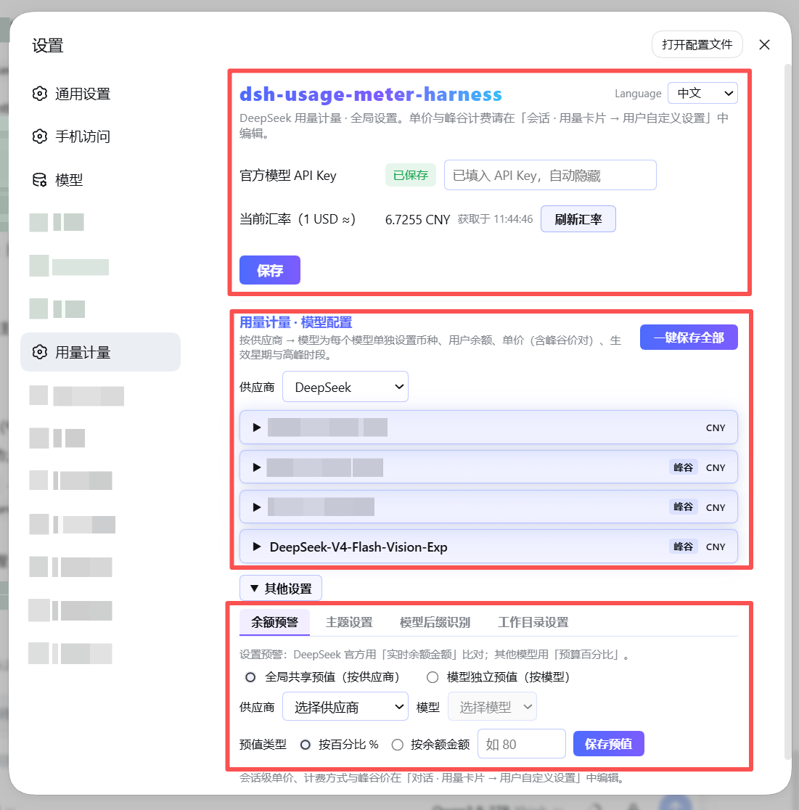
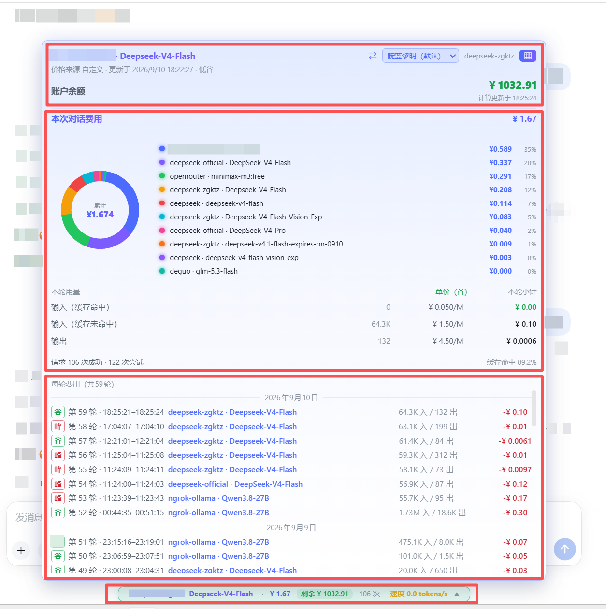

# dsh-usage-meter-desktop

[English](README.md) | [简体中文](README.zh-CN.md)

DeepSeek Harness（DSH）的**实时用量 / 费用 / 余额计量插件**。
在聊天输入框旁直接看到 token 用量、消费金额和真实钱包余额——官方 DeepSeek
模型和你注册的任何自定义模型都支持。



## 3.1.0 —— 一个包，两代宿主都能装

**同一个包，装到 DSH 0.1（web profile）和 DSH 0.2（桌面版）都能跑。** 不用挑版本，不用按宿主打补丁。

- **装的东西是同一个**。`dsh-usage-meter-desktop` 3.1.0 就是两代宿主都该装的包。
- **升级是原地替换**。插件 id、数据目录、配置文件名都没变，账本、定价、设置全部保留。
- **没有 HTTP 服务的宿主也能跑**。读数、记账、设置界面照常，`/api/usage-meter/*` 那几个接口只是不注册，也不报警告。

| | 2.0.x（网页版构建） | 3.x（本构建） |
| --- | --- | --- |
| npm 包名 | `@faith1688/dsh-usage-meter-harness` | `dsh-usage-meter-desktop` |
| 插件 id | `usage-meter` | `usage-meter-desktop` |
| 数据目录 | `$DSH_HOME/usage-meter/` | `$DSH_HOME/usage-meter-desktop/` |
| 配置文件名 | `usage-meter.json` | `usage-meter-desktop.json` |
| 适用宿主 | DSH 0.1 / web profile | **DSH 0.1 网页版 + DSH 0.2 桌面版** |

数据目录和文件名**刻意分开**：两个版本同时装着时不会互相覆盖配置和账本。

### 3.0.0 相对 2.0.39 的改动清单

### 3.0.0 有什么变化

**一、能在 DSH 0.2（桌面版）上跑了**

桌面版删掉了旧版依赖的设置接口，导致整个插件起不来。3.0.0 自带一套设置存储，两代都能跑。

**二、从本机其它计费插件导入定价**

模型编辑区右上角除「导出计费配置 / 导入计费配置」外，多了第三个按钮
**「导入其它插件计费配置」**：

- 自动扫描本机已装的计费插件（当前支持 `dsh-cost-meter`），列出它认得的所有模型定价；
- 按模型名相似度排序，最像的排最前，不用你一行行找；
- 点「用这条」直接写进**这张卡对应的模型**，来源币种自动按当前汇率换算。

**三、峰谷时段随单价一起导入**

只导峰价不导时段，等于把正确的价格套进错误的时间段。3.0.0 把峰谷窗口和星期一起带过去，并把来源里的 UTC 小时换算成北京时间。

**四、平坦定价不再显示成「含峰谷」**

以前是按整份配置判断：只要有一个模型配了峰谷，所有模型都挂上「含峰谷」徽章——哪怕峰价和谷价三项完全一样。现在按行判断：三项相等就是平坦定价，不挂徽章、不写峰谷字段；之前导入过的假峰谷，下次读配置时会自动变回平坦。

本机 832 条候选，修前全部显示「含峰谷」，现在**只剩 9 条**，都是 DeepSeek 官方系列（`deepseek-flash` / `deepseek-v4-flash` / `deepseek-v4-pro` / `deepseek-v4.1-flash` 及其 opencode-go 渠道）。Kimi、Qwen、Gemini 等全部变平坦。

**五、改价立即生效**

点「用这条」后不用再收起胶囊重开，单价马上更新。

**六、设置页更清楚 + 可导出定价**

- 设置页拆成「全局配置」「模型定价」两张卡，API Key / 汇率 / 官方价格收进第一张；模型卡头部显示供应商数与模型数。
- 胶囊里的改价抽屉新增**「导出当前定价」**：把当前模型的单价 + 峰谷时段导出成计费配置文件，落到 `$DSH_HOME/usage-meter-desktop/exports/`。

## 安装

这个包是**桌面版（3.0.0）**，从本地 tgz 装进 `desktop` profile —— 不走 npm 源，也不碰网页版那套。

**1. 打包（或直接用 release 附件里那份）：**

```bash
cd desktop
npm install          # esbuild + typescript
npm run bundle       # 先 tsc 出宿主半边，再 esbuild 出 lib/client.js
npm pack             # -> dsh-usage-meter-desktop-3.0.0.tgz
```

**2. 放进 desktop profile，并把 profile 依赖指过去：**

```
$DSH_HOME/profiles/desktop/dsh-usage-meter-desktop-3.0.0.tgz
```

```jsonc
// $DSH_HOME/profiles/desktop/package.json
{
  "dependencies": {
    "dsh-usage-meter-desktop": "file:./dsh-usage-meter-desktop-3.0.0.tgz"
  }
}
```

**3. 登记 bundle，然后重启 DSH：**

```jsonc
// dsh.profile.bundles 里要有这个插件 id
"dsh-usage-meter-desktop"
```

```bash
# 在 profile 目录里
pnpm install
# 然后重启桌面版（或 `dsh web`）
```

**怎么确认加载成功：** 发一条消息后，聊天输入框旁边会出现用量胶囊。没出现就看宿主日志里有没有
`1 entry did not activate` —— 有的话说明在 DSH 0.2 上装了 2.0.x，或者 bundle id 没登记。

**升级：** 换掉 tgz、改 `package.json` 里的版本号，重跑 `pnpm install`，重启。数据目录
`$DSH_HOME/usage-meter-desktop/` 不会丢。

---

想装的是**网页版（2.0.x）**？它在仓库根目录 —— 见 [`../README.zh-CN.md`](../README.zh-CN.md)。

## 网页版安装（2.0.x，仅作参考）

> 下面这三种方式装的是**网页版**，不是这个包。留在这里只因为这个文件是从网页版 README 分出来的。

> 前置（方式一、二）：DSH CLI 本身基于 pnpm，每台机器装一次即可：
> `npm install -g pnpm`（或 `corepack enable`），用 `pnpm --version` 验证。

三选一。**方式一和方式二需要 pnpm**（DSH CLI 本身的一次性前置要求，任意插件都一样）：
`npm install -g pnpm` 或 `corepack enable`。

### 方式一 —— npm 源（需要 pnpm）

```bash
dsh plugin --profile web add --verbose @faith1688/dsh-usage-meter-harness@latest
```

（`--verbose` 显示安装进度，可去掉。`@latest` 显式请求最新版——请始终这样安装。）

### 方式二 —— GitHub 源（需要 pnpm）

```bash
dsh plugin --profile web add --verbose github:faith1688/dsh-usage-meter-harness#main
```

（`--verbose` 显示安装进度。）

### 方式三 —— 一行命令安装，不需要 pnpm（推荐）

```bash
npx -y @faith1688/dsh-usage-meter-harness@latest
```
一条命令：自动装进 DSH web profile 并注册 bundle（幂等）。
（`@latest` 显式请求最新版——请始终这样安装。）

不想用 npx？仓库里也带了同样的脚本：

Windows（cmd）：

```bat
curl -fsSL https://raw.githubusercontent.com/faith1688/dsh-usage-meter-harness/main/scripts/install.cmd -o "%TEMP%\um-install.cmd" && "%TEMP%\um-install.cmd"
```

Linux / macOS：

```bash
curl -fsSL https://raw.githubusercontent.com/faith1688/dsh-usage-meter-harness/main/scripts/install.sh | sh
```

脚本会自动完成全部步骤：进入 DSH web profile → 安装包（可见进度）→ 注册
`dsh.profile.bundles`（幂等，升级后重跑安全）。

> 注意：方式三用的是原生 `npm`，**不做 pnpm 协调**。如果你的 profile 由 pnpm
> 管理（`dsh plugin` 的默认方式），推荐用方式一。

任选一种方式后：**重启 `dsh web`**。

## 更新

桌面版走本地 tgz，升级就是四步：

1. 把 profile 里的旧 `dsh-usage-meter-desktop-<旧版本>.tgz` 换成新的。
2. 改 `$DSH_HOME/profiles/desktop/package.json` 里的版本号。
3. 在 profile 目录里 `pnpm install`。
4. 重启 DSH。

`$DSH_HOME/usage-meter-desktop/`（配置、账本、导出）在升级中不会被动到 —— 换的只是
`node_modules/` 里的代码。

---

下面这段是**网页版（2.0.x）**的升级路径，留作参考。网页版升级务必显式指定新版本，
不带版本号的 `add` 会被 pnpm 判定"已满足"而跳过：

```bash
dsh plugin --profile web add @faith1688/dsh-usage-meter-harness@latest
```

或在 profile 目录（`~/.dsh/profiles/web`）里执行：

```bash
pnpm update @faith1688/dsh-usage-meter-harness
```

（也可以指定精确版本，如 `...@1.0.28`。）

> **在插件市场里点「更新」失败？** 如果提示「更新目标为 vX，但实际安装为 vY；已自动
> 恢复原版本」，那是 pnpm 的**新版本冷静期**（刚发布的版本约 24 小时内会被跳过），
> 不是你装坏了，配置和余额数据都没动。**等 24 小时**再点一次即可；想立刻升级就用
> 下面的 `npx` 方式，或在 profile 的 `pnpm-workspace.yaml` 里把
> `minimumReleaseAgeExclude` 加上本包名（不带版本号）。

更新后：**重启 `dsh web`**（或刷新浏览器页面）。注意：**重启本身不会拉取
新版本**——它只是重新加载 `node_modules` 里已有的包。

**为什么这样更新绝不会产生重复挂载记录、也绝不会动你的配置：**

- 挂载记录在**插件包内部**（`cordis.patch.yml`，`dsh.bundle` 机制）。每个版本
  自带完整的一条挂载记录；DSH 启动时从已安装的包里读取——装上新版本包，
  自动就带上新版本的正确记录。
- 安装器只改 profile 的 `package.json`（`dsh.profile.bundles`，自动去重）和
  `node_modules`。**从不写** profile 根目录的 `cordis.patch.yml`——你在里面
  自己加的内容（或其他插件的配置）原样保留。
- 重复挂载记录只可能发生在：你**手动**往 profile 根 `cordis.patch.yml` 里加了
  相同的 `id`——安装器永远不会这样做。

## 功能一览

### 对话用量卡（聊天输入框旁）

| 功能 | 说明 |
| --- | --- |
| 实时费用 | 会话累计费用，CNY / USD 可切换，每步实时更新 |
| Token 明细 | 输入(未命中) / 缓存命中 / 缓存写入 / 输出 分桶统计 |
| 本轮用量面板 | 逐轮小计，单价带峰/谷标记 |
| Token 速度 | 模型输出时实时 tokens/s；输出停止或工具执行时自动清零，不冻结旧值 |
| 缓存命中率 | 会话级缓存命中占比 |
| 账户余额 | DeepSeek 官方真实钱包余额；其他厂商按本地账本估算 |
| 预算与剩余 | 设置预算后显示已用 / 剩余 / 超支 |

### 计费引擎

| 功能 | 说明 |
| --- | --- |
| 6 种计费模板 | 基础 · 缓存命中/未命中 · 峰谷分时（DeepSeek 官方时段）· 缓存写入+命中 · 输入+输出合并 · Batch 半价 |
| 自定义单价项 | 最多 4 行自定义行；弹窗与你配置的内容逐格一致 |
| 峰谷分时计费 | 北京时间星期 + 时段窗口，支持跨零点时段；按每次请求的发起时刻计费 |
| 回合归因精确 | 每轮费用记在真正执行它的模型名下——会话中途切模型不会把未结束或已结束的回合重新打标；回合币种在本轮首个计费用量到达时定标，美元定价的回合换算正确 |
| 每模型独立计价 | 每个模型可单独设置币种（CNY/USD）、单价与余额 |
| 共享余额钱包 | 一个供应商下所有模型共用一个钱包，一个复选框开关 |
| 官方价预填 | DeepSeek 官方模型自动预填官方价与官方峰谷时段 |
| 内置价格表 | 内置 19 家厂商 137 个模型价格；可选 LiteLLM 形状的远端价格源 |
| 汇率自动刷新 | USD→CNY 自动获取，超过 24 小时自动更新 |
| 一键同步官方价格 | 设置页一键抓取 DeepSeek 官网价格页，解析最新价格与峰谷时段并写入覆盖（需先填全局 API Key），随时保持官方价最新 |
| 旧数据迁移 | 旧版手动初始余额/充值记录自动迁移为厂商钱包，余额不丢失 |

### 设置与体验

| 功能 | 说明 |
| --- | --- |
| 中英双语界面 | 设置页右上角语言切换：跟随系统 / 中文 / English，设置页与弹窗全部即时生效，选择自动记住。只影响显示，绝不改动你保存的数据 |
| 主题 | 20 个内置主题（浅色系在前、深色系在后，默认 forest-beach-dawn）+ 每个主题可自定义胶囊颜色与呼吸颜色——用量弹窗顶部快速切换，设置页完整配色，选择保存在本机 |
| 使用中锁定 | 模型正在生成时锁定其编辑器，保证进行中的轮次价格一致 |
| 弹窗所见即所得 | 用量卡的行名与格子完全抄自你选择的模板 |
| 无侵入 | 标准 DSH cordis 插件；不改动其他插件，不动 DSH 核心文件 |
| 峰谷胶囊 | 谷价时胶囊变浅绿、峰价时变浅红（计费中带柔和呼吸光晕），一眼看清当前是峰价还是谷价 |
| 未保存/已保存 | 模型卡编辑后显示「未保存」，点保存后显示「已保存」——不再有含糊的「保存中」 |
| 当前会话看板 | 弹窗默认直接展开「当前会话」视图（总计 + 分项金额 + 每轮费用）；坐标标签用 `provider · model`，同名官方/自定义模型一眼可分 |
| DS API Key 守卫 | 非官方模型勾选「DS API Key」时提示该选项仅 DeepSeek 模型使用；自定义模型绝不回落官方全局 key，未设置显示「未配置」 |

## 支持的模型

- **DeepSeek 官方模型**（`deepseek-chat`、`deepseek-reasoner` 等）：自动预填官方价，
  通过 API Key 显示真实钱包余额。
- **任意自定义模型**（DSH 注册的 OpenAI 兼容厂商、Ollama、OpenRouter 等）：
  自行填写单价与余额即可，其余功能完全一致。

## 截图

设置页：


用量弹窗：



## 配置

所有配置都在 `usage-meter` 设置命名空间，可直接在插件界面里修改：

| 键 | 类型 | 默认 | 说明 |
| --- | --- | --- | --- |
| `currency` | string | `CNY` | 显示币种 |
| `budget` | number | – | 会话预算；设置后显示「剩余」 |
| `priceSourceUrl` | string | – | LiteLLM 形状的价格 JSON 地址；可选 |
| `refreshIntervalMs` | number | 4h | 价格 / 余额 / 汇率刷新周期 |
| `deepseekApiKey` | secret | – | 仅用于查询 DeepSeek 余额（AES 加密存储；**不读取**环境变量 `DEEPSEEK_API_KEY`） |

## 兼容性

- 需要 Node.js ≥ 22。
- peer 版本跟随所支持的 DSH 版本（见 `package.json`）；DSH 升级不影响本插件，
  本插件也不会影响你的其他插件。

## License

MIT © [faith1688](https://github.com/faith1688)

## 隐私

- 插件**无任何遥测、无统计**。
- 网络请求全部由你主动发起，共四处可选：① 用你自己配置的 API Key 查询 **DeepSeek 官方余额接口**；
  ② 获取公开的 USD→CNY 汇率；③ 一键同步官方价格时抓取 DeepSeek 官网价格页；
  ④ 仅当价格页规则解析失败时，把该页内容发给 DeepSeek 官方接口（用你的全局 Key）提取。
  除此之外没有任何数据离开你的机器。
- 源码 MIT 协议，GitHub 上完全可查。
